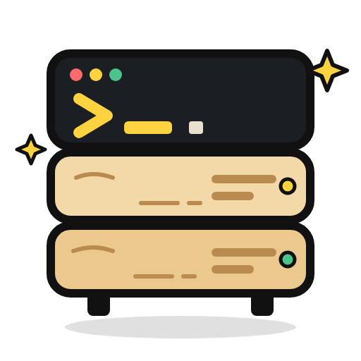
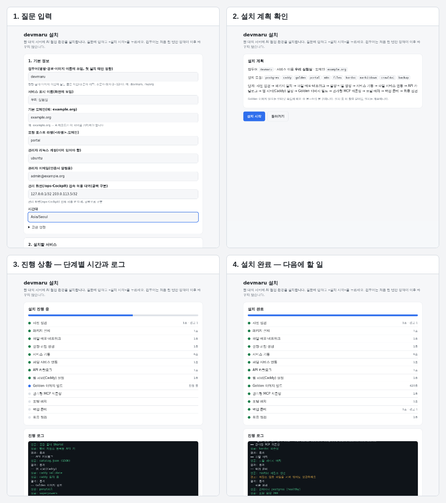
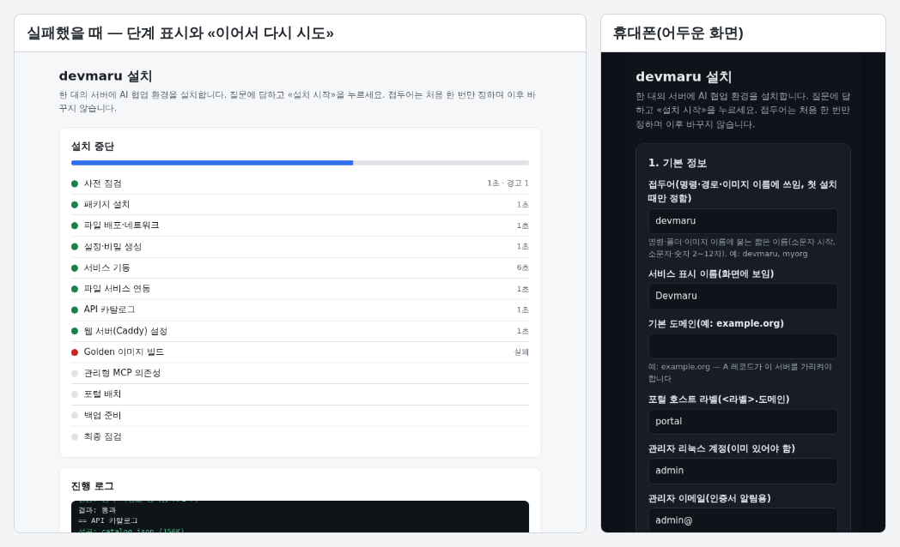
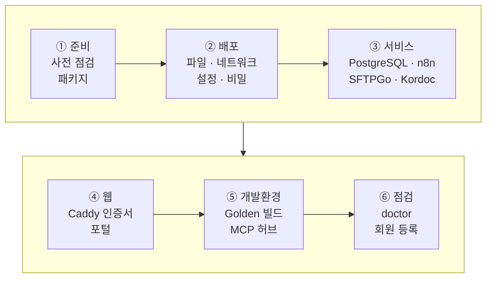

<p align="center"></p>

# 데브마루 — 소규모 조직의 셀프호스팅 개발 기반 인프라

> 남는 PC를 서버로 활용해 **우리 팀의 개발 마루**로 만듭니다.
>
> 회원마다 개발환경(Claude Code · Codex)과 Paseo 원격 접속, 웹 공개, 데이터베이스, 문서 변환, 자동화, 파일 공유를 한 번에 설치합니다.
>
> 서비스 이름 · 도메인 · 명령 접두어는 설치할 때 직접 정합니다.
>
> 셀프호스팅 · 서비스별 선택 설치 · MIT 라이선스 · 1.3.0 베타

| 구분 | 내용 |
|---|---|
| **릴리스** | [v1.3.0](https://github.com/bigone-kcrew/devmaru/releases/tag/v1.3.0) |
| **필요 환경** | Ubuntu 26.04 (x86_64) · 메모리 8GB+ (16GB 권장) · 디스크 60GB+ |
| **설치 시간** | 약 18분 (Golden 빌드 포함, 네트워크에 따라 다름) |
| **이런 곳에** | 공공 실험실 · 연구 모임 · 동호회 · 소규모 개발팀 |
| **라이선스** | MIT ([`LICENSE`](LICENSE)) |





위 화면은 `sudo python3 /opt/devmaru-kit/bin/devmaru-install --web` 으로 여는 웹 설치 화면입니다(예시 값 사용). 각 화면의 원본 크기 이미지는 [`docs/assets/screens/`](docs/assets/screens/)에, 터미널로 설치할 때의 화면은 [설치 화면 모음](docs/INSTALL-SCREENS.md)에 있습니다.

---

## 회원은 무엇을 할 수 있나요

> 회원은 **개발환경을 꾸밀 필요가 없습니다.**
>
> 계정을 받아 SSH 로 접속하는 순간, 에이전트·스킬·MCP 가 갖춰진 자기 개발환경 안입니다.
>
> 에이전트와 함께 만들고, DB 를 쓰고, 정적 페이지든 서버 앱이든 바로 공개합니다.

| 하고 싶은 일 | 이렇게 됩니다 | 설정 |
|---|---|---|
| **접속** | `ssh <ID>@서버` 로 로그인하면 내 개발환경으로 자동 입장 | 자동 |
| **원격** | 등록하면 Paseo 앱용 QR·링크가 만들어짐 | 자동 |
| **에이전트** | Claude Code · Codex · 스킬 22종이 이미 설치됨 | 자동 |
| **정적 공개** | `publish/` 폴더에 파일을 두면 `<ID>.도메인/<프로젝트>/` (1분 이내) | 자동 |
| **서버 앱 공개** | `<접두어>-app publish <이름> <포트>` → `<이름>.도메인` | 자동 |
| **내 DB** | 회원 전용 PostgreSQL DB 자동 준비, 다른 회원 DB 는 막힘 | 자동 |
| **문서·수집 MCP** | Kordoc · MarkItDown · Crawl4AI 도구를 에이전트가 바로 호출 | 자동 |
| **파일** | SFTP·웹 파일 계정 자동 생성, SSH 비밀번호와 동기화 | 자동 |
| **n8n 자동화** | 서비스는 설치됨 — 관리자가 소유자 계정을 만든 뒤 회원 초대 | 수동 |

**이렇게 흘러갑니다**

1. 관리자가 회원을 등록하면 초기 비밀번호를 받습니다. 첫 로그인에서 비밀번호를 바꿉니다.
2. SSH 로 접속하면 자동으로 내 개발환경(`dev-<ID>`)에 들어갑니다. 또는 Paseo 앱으로 연결합니다.
3. 에이전트에게 «이런 사이트를 만들어 줘»라고 말합니다. 스킬과 MCP 는 이미 준비돼 있습니다.
4. 만든 결과를 정적 페이지로, 또는 서버 앱으로 공개합니다. 내 DB 가 필요하면 바로 연결합니다.

> 는 빈 서버에 설치한 뒤 **회원 계정으로 실제로 확인**한 항목입니다. (내부 인증서 모드, 서버 한 대)
>
> 서버 앱은 멤버당 5개 · 기본 30일 만료 같은 규칙이 자동 적용됩니다. 규칙은 `<접두어>-app ports` 로 확인합니다.
>
> Paseo 앱에서의 실제 연결과 n8n 회원 초대는 앱·메일 설정이 필요해 이 시험에 포함하지 않았습니다.

---

## 어떤 서비스인가요

개발 환경을 사람마다 따로 꾸리면 시간이 많이 들고, 서버·인증서·데이터베이스를 직접 챙기기도 부담입니다.
데브마루는 서버 한 대에 **회원별 개발환경과 그 뒤를 받치는 서비스**를 한 번에 올려 줍니다.

- 회원은 자기 컨테이너에서 Claude Code · Codex 같은 에이전트와 함께 작업합니다.
- 휴대폰이나 PC의 Paseo 앱으로 터미널 없이 에이전트를 지켜보고 지시합니다.
- 만든 사이트·앱은 `<ID>.도메인` 으로 바로 공개하고, 필요하면 회원별 DB를 받습니다.

관리자는 질문 몇 개에 답하면 됩니다. 이름 · 도메인 · 접두어도 그때 정합니다.

> **이름 뜻** — 데브(dev, 개발) + 마루(한옥에서 식구들이 모이는 널찍한 마루, 그리고 «기반·꼭대기»를 뜻하는 우리말). 개발자들이 모여 일하는 기반 자리입니다.

---

## 무엇을 주나요

| 구성 | 쓰임 |
|---|---|
| **회원별 개발환경** | 격리된 컨테이너 · Claude Code · Codex · gh/glab · 스킬 22종 |
| **Paseo 원격 접속** | 등록하면 만들어지는 QR·링크로 Paseo 앱에서 바로 연결 |
| **웹 공개** | 정적 사이트·앱을 `<ID>.도메인` 으로 공개 (자동 인증서) |
| **PostgreSQL 18** | pgvector · pg_bigm 포함, 회원별 DB 발급 |
| **문서·수집** | Kordoc(HWP) · MarkItDown · Crawl4AI 를 MCP 로 바로 사용 |
| **자동화·파일** | n8n · SFTPGo(웹/SFTP 파일 서비스) |
| **포털** | 회원용 안내(Guide) · Skills · Tools 페이지 |
| **운영 도구** | `doctor` · `update` · restic 백업 · Cockpit · 웹 설치 화면 |

모든 서비스는 **선택**할 수 있습니다. (필수: PostgreSQL · Caddy · Golden · 포털)

---

## 설치

### 1. 준비

- **서버** — Ubuntu 26.04 LTS (x86_64), 인터넷 연결
- **도메인** — A 레코드: `도메인`, `portal.도메인` 필수 (`*.도메인` 와일드카드 권장)
- **포트** — 80 · 443 개방 (인증서 자동 발급)
- **관리자 계정** — `sudo` 가능한 리눅스 계정

### 2. 설치 명령

```bash
curl -fsSL https://raw.githubusercontent.com/bigone-kcrew/devmaru/main/install.sh | sudo bash
```

> GitLab 저장소(`bigone-kised/devmaru`)는 점검 중이라 **GitHub 릴리스**에서 받습니다. 예전처럼 GitLab 에서 받으려면 `DEVMARU_SOURCE=gitlab` 을 앞에 붙입니다(`curl … | sudo DEVMARU_SOURCE=gitlab bash`). `sudo <접두어>-update` 도 같은 규칙입니다.

질문에 답하면 됩니다. Enter 만 누르면 [기본값]을 씁니다.

### 웹 화면으로 설치하려면

```bash
sudo python3 /opt/devmaru-kit/bin/devmaru-install --web
```

기본은 서버 안에서만 열립니다.
내 PC에서는 `ssh -L 8765:127.0.0.1:8765 <사용자>@<서버>` 터널을 연 뒤, 터미널에 표시된 주소를 여세요.
자세한 내용은 [설치 가이드](docs/INSTALL.md)에 있습니다.

### Windows PC 에서 설치하려면

데브마루는 **Ubuntu Server 26.04** 용입니다. Windows 11 PC 를 서버로 쓴다면:

- **권장 — VM**: Hyper-V 또는 VirtualBox 에 **Ubuntu Server 26.04 LTS VM** 을 만들고, VM 안에서 위 «설치 명령» 을 그대로 실행합니다. Windows 위에서 직접 시험하지는 않았습니다(Ubuntu 26.04 VM 에서는 시험했습니다).
- **실험적 — WSL2**: 준비 스크립트 [`windows/install-windows.ps1`](windows/install-windows.ps1) 로 distro 를 만든 뒤 distro 안에서 설치합니다. Windows 11 PC 한 대에서 시험했습니다.

VM 만드는 순서와 WSL2 준비·되돌리기는 [설치 가이드의 Windows 절](docs/INSTALL.md#windows-pc-에-설치하려면)에 있습니다.

### 3. 설치가 끝나면

```bash
sudo <접두어>-doctor                                         # 상태 점검
sudo <접두어>-member-add alice --email alice@example.org     # 첫 회원 등록
```

---

## 자주 쓰는 옵션

| 옵션 | 뜻 |
|---|---|
| `--plan` | 아무것도 바꾸지 않고 할 일만 표시 |
| `--resume` | 실패한 단계부터 이어서 |
| `--config site.env --yes` | 질문 없이 자동 설치 (원격·자동화) |
| `--skip-golden` | Golden 이미지 빌드를 나중으로 미룸 |
| `TLS_MODE=internal` (설정 파일) | 공인 도메인 없는 내부망 설치 (내부 인증서) |

---

## 어떻게 만들었나요

| 단계 | 하는 일 |
|---|---|
| **설치기** | Python 표준 라이브러리만 쓰는 `devmaru-install` — 터미널 질문 · `--config` · 웹 화면, 실패하면 그 단계부터 재개 |
| **템플릿** | 이름·도메인·접두어가 들어갈 자리를 `@@토큰@@` 으로 두고, 설치할 때 사용자가 정한 값으로 렌더링 |
| **서비스** | Docker Compose — 선택한 서비스만 올리고 PostgreSQL 은 설치 서버에서 빌드 |
| **웹 서버** | Caddy — 호스트마다 인증서를 자동 발급하고 회원 사이트 블록을 생성 |
| **개발환경** | Golden 이미지를 업스트림에서 **버전·해시를 고정해 내려받아** 설치 서버에서 직접 빌드 |



---

## 함께 쓰는 오픈소스

데브마루는 아래 프로젝트들을 **설치할 때 내려받아 묶어 주는** 도구입니다.
각 프로젝트의 주인과 라이선스는 해당 저장소를 따르며, 이 저장소에는 포함되어 있지 않습니다. ([`THIRD_PARTY.md`](THIRD_PARTY.md))

| 분류 | 프로젝트 |
|---|---|
| **에이전트** | [Claude Code](https://github.com/anthropics/claude-code) · [Codex](https://github.com/openai/codex) · [Antigravity CLI](https://github.com/google-antigravity/antigravity-cli) · [Paseo](https://paseo.sh) ([GitHub](https://github.com/getpaseo/paseo)) |
| **개발 도구** | [gh](https://cli.github.com) · [glab](https://gitlab.com/gitlab-org/cli) · [Playwright](https://playwright.dev) |
| **스킬 · 플러그인** | [Superpowers](https://github.com/obra/superpowers) · [ponytail](https://github.com/DietrichGebert/ponytail) · [archify](https://github.com/tt-a1i/archify) |
| 〃 | [effective-html](https://github.com/plannotator/effective-html) · [UI/UX Pro Max](https://github.com/nextlevelbuilder/ui-ux-pro-max-skill) · [agent-browser](https://github.com/vercel-labs/agent-browser) |
| **문서 변환 · 수집** | [Kordoc](https://github.com/chrisryugj/kordoc) (HWP·HWPX) · [MarkItDown](https://github.com/microsoft/markitdown) · [Crawl4AI](https://github.com/unclecode/crawl4ai) |
| **공개 API 목록** | [public-apis-4Kr](https://github.com/yybmion/public-apis-4Kr) |
| **데이터베이스** | [PostgreSQL](https://www.postgresql.org) · [pgvector](https://github.com/pgvector/pgvector) · [pg_bigm](https://github.com/pgbigm/pg_bigm) |
| **서비스** | [n8n](https://n8n.io) ([GitHub](https://github.com/n8n-io/n8n)) · [SFTPGo](https://sftpgo.com) ([GitHub](https://github.com/drakkan/sftpgo)) |
| 〃 | [Ollama](https://ollama.com) · [Uptime Kuma](https://github.com/louislam/uptime-kuma) |
| **인프라** | [Docker](https://www.docker.com) · [Caddy](https://caddyserver.com) · [Cockpit](https://cockpit-project.org) · [restic](https://restic.net) |

ALIO · K-Startup 같은 외부 공개 MCP 서비스는 기본에서 빼고, 관리자가 `<접두어>-mcp-remote enable <이름>` 으로 켜는 **후보**로만 제공합니다.
(서비스 쪽에서 GitHub 로그인 후 토큰을 신청해야 합니다.)

---

## 알아 두세요

- Ubuntu 26.04 x86_64 **한 대에서만** 시험했습니다. 회원이 많을 때의 부하는 아직 보지 못했습니다.
- 메일 자동 발송(n8n 워크플로)과 SMB over QUIC 는 설치기 단계가 없습니다. 수동으로 구성합니다.
- SSH 접속 포트는 서버 sshd(기본 22)를 따릅니다. 다른 포트면 설정 파일에 `SSH_PORT` 를 넣어 안내 문구를 맞춥니다.
- 웹 관리 콘솔(멤버·업데이트·상태 화면)은 아직 없습니다. 설치용 웹 화면만 제공합니다.
- 공개 도메인에서의 인증서 발급 흐름은 내부 인증서 모드로만 시험했습니다.
- Paseo 페어링 링크는 재발급해도 같은 값인 **영구 자격증명**처럼 다뤄야 합니다. 회원에게만 전달하세요.
- 1.2.1 까지는 GitLab 서버의 푸시 보안 스캔(Gitleaks · Semgrep · OSV-Scanner · Trivy · Syft)을 통과했습니다(억제한 규칙 1건은 [구조 문서](docs/ARCHITECTURE.md)에 근거와 함께 적었습니다). GitHub 로 옮긴 뒤의 릴리스는 `check-release.sh`(비밀 패턴 · 조직 이름 잔여 · 렌더링 점검)를 통과한 것만 올리며, 위 다섯 스캐너는 이 저장소에서 돌리지 않았습니다.

---

## 문서

| 문서 | 내용 |
|---|---|
| [ 설치 가이드](docs/INSTALL.md) | 처음 설치하는 분용 — 준비물 · 질문 · 진행 · 문제 해결 |
| [ 구조](docs/ARCHITECTURE.md) | 유지보수자용 — 이름 체계 · 단계 · 모듈 추가 · 보안 스캔 예외 |
| [ Windows 에서 설치](docs/INSTALL.md#windows-pc-에-설치하려면) | VM(Hyper-V · VirtualBox) 만드는 순서 · WSL2(실험적) 준비 스크립트 |
| [ 설치 화면](docs/INSTALL-SCREENS.md) | 터미널·웹 설치 화면 미리보기 |
| [ 운영 가이드](docs/OPERATIONS.md) | 회원 추가·삭제 · DB · 웹 공개 · 업데이트 · 백업 |
| [ 접근 정책](docs/ACCESS.md) | workspace·공유 공간 읽기/쓰기 권한 |
| [ 라이브 서버 이관](docs/MIGRATE-LIVE.md) | 큰 데이터를 두 서버가 켜진 채 rsync 로 옮기고 짧게 전환(IP 교체·함정 목록) |
| [ 메일](docs/MAIL.md) · [ SMB](docs/SMB.md) · [ n8n](docs/N8N.md) | 선택 모듈 안내 |
| [ AI 관리자](docs/ADMIN-AGENT.md) · [`AGENTS.md`](AGENTS.md) | Claude Code·Codex 로 설치·운영 |
| [ 로드맵](docs/ROADMAP.md) · [ 변경 내역](CHANGELOG.md) | 앞으로의 계획 · 버전별 변경 |
| [ 서드파티 목록](THIRD_PARTY.md) | 내려받아 쓰는 구성요소와 라이선스 |

---

## 라이선스

이 저장소의 코드는 **MIT** 입니다. ([`LICENSE`](LICENSE))
서드파티 구성요소는 각자의 라이선스를 따릅니다.
