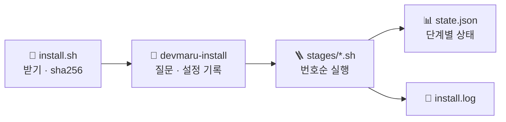

# 구조 (유지보수자용)

> 저장소 구성, 이름 체계, 설치 흐름, 모듈 추가 방법, 보안 스캔 예외를 설명합니다.
>
> 설치만 하려는 분은 [설치 가이드](INSTALL.md)를 보세요.

---

## 저장소 구성

| 경로 | 역할 |
|---|---|
| `install.sh` | 부트스트랩: OS 확인 → 릴리스 tarball 받기 → sha256 검증 → `/opt/devmaru-kit` 에 풀기 → `devmaru-install` 실행 |
| `bin/devmaru-install` | 설치기(Python 표준 라이브러리만): 질문 · `--config` · `--web`, 단계 실행, 상태 파일, 재개 |
| `lib/devmaru_render.py` | 템플릿 렌더러(토큰 치환 + 문법 검사) |
| `lib/wizard.html` | 웹 설치 화면 |
| `stages/NN-*.sh` | 설치 단계(번호순, 여러 번 실행해도 안전) |
| `config/modules.list` · `networks.list` | 모듈 · 도커 네트워크 목록 |
| `tree/` | **템플릿 트리** — 사용자가 고른 접두어 · 이름 · 도메인이 `@@토큰@@` 으로 들어갈 자리 |
| `docs/` | 설치 가이드 · 구조 |
| `tools/` | 관리자용 도구 — `devmaru-fleet`(원격 점검·설치, [FLEET](FLEET.md)) · `devmaru-migrate-live/`(라이브 서버 이관, [MIGRATE-LIVE](MIGRATE-LIVE.md)) |

---

## 이름 체계

이름은 두 층으로 나뉩니다.

| 층 | 내용 |
|---|---|
| **고정 중립 층** (접두어 `@@PFX@@` 로 렌더링) | 명령 `<접두어>-*` 경로 `/opt/<접두어>` · `/srv/<접두어>` · `/etc/<접두어>` 그룹 `<접두어>` 이미지 `<접두어>-dev` · `<접두어>-postgres` 네트워크 `<접두어>-*-net` 회원 컨테이너 `dev-<ID>` |
| **설정 층** (`/etc/<접두어>/site.env`) | `BRAND`(표시 이름) · `DOMAIN` · 호스트(`PORTAL_HOST` `FILES_HOST` …) `ADMIN_USER` · `ADMIN_CIDRS` · `TZ` · `GID` · `MODULES` · `TLS_MODE` · `GOLDEN_VOICE` |

**템플릿 토큰**

`@@PFX@@` · `@@PFX_UP@@`(대문자, 환경변수 접두) · `@@BRAND@@` · `@@DOMAIN@@` · `@@<라벨>_HOST@@` · `@@ADMIN_USER@@` · `@@GID@@` · `@@TZ@@` · `@@SERVER_IP@@` · `@@SFTP_BIND@@` · `@@ADMIN_CIDRS@@`

> 접두어는 첫 설치 때 **한 번만** 정합니다.
>
> 경로 · 이미지 · 네트워크 · 회원 컨테이너가 모두 이 이름을 쓰므로 나중에 바꾸지 않습니다.

---

## 설치 흐름

`devmaru-install` 은 `/etc/<접두어>/site.env` 를 기록한 뒤 각 단계를 환경변수와 함께 실행합니다.
상태는 `/var/lib/<접두어>/install/state.json`, 로그는 `/var/log/<접두어>-install.log` 에 남습니다.

| 단계 | 하는 일 |
|:---:|---|
| 00 | **사전 점검** — OS · 메모리 · 디스크 · 인터넷 · 포트 · DNS |
| 10 | **패키지** — 기본 도구 · Docker · Caddy |
| 20 | **배포** — `tree/` 렌더링(미해결 토큰 · 문법 검사) → 서버 경로에 배치, 그룹 · 디렉터리 · 도커 네트워크 |
| 30 | **설정** — 비밀 생성과 env 파일(이미 있으면 유지) |
| 40 | **서비스** — postgres 빌드, 선택 서비스 `compose up`, DB · 확장 |
| 45 | **파일 연동** — SFTPGo 관리자 API 키 · 공용 폴더 |
| 47 | **카탈로그** — 공개 API 목록 동기화 |
| 48 | **n8n 워크플로** — 템플릿 목록·설치(선택) |
| 52 | **메일** — SMTP·n8n 웹훅 설정(선택) |
| 50 | **Caddy** — `Caddyfile.tmpl` + 선택 모듈 → 검증 → 적용 |
| 54 | **웹 관리 화면**(선택 모듈 `admin`) — 도우미(root)·웹(비특권) 유닛, PAM 서비스 파일, Caddy 블록, 감사 로그 회전 |
| 55 | **Cockpit**(선택) |
| 56 | **SMB**(선택 모듈 `smb`) |
| 60 | **Golden** — 업스트림 재료 다운로드(`golden/fetch-upstream.sh`, 버전 · 커밋 · sha256 고정) → 이미지 빌드 |
| 65 | **MCP 의존성** — 관리형 MCP 서버 `npm ci`(Golden 이미지로 실행) |
| 70 | **포털** — 정적 페이지 배치 |
| 80 | **백업** — restic 저장소 · 암호 |
| 85 | **타이머** — site-sync · app-sync · db-policy |
| 90 | **점검** — `<접두어>-doctor` |

---

## 모듈 추가하기

1. `tree/compose/<이름>/compose.yml` 을 추가합니다. 접두어 토큰을 쓰고 외부 네트워크는 `@@PFX@@-service-net` 입니다.
2. `config/modules.list` 에 한 줄을 추가하고, 필요한 env 는 `stages/30-config.sh` 에서 생성합니다.
3. 웹 노출이 필요하면 `tree/caddy/modules/<이름>.caddy` 와 `stages/50-caddy.sh` 의 조합 줄을 추가합니다.
4. `check-release.sh` 로 토큰 · 조직 이름 잔여를 점검합니다.

---

## 업데이트

`<접두어>-update` 가 새 릴리스를 받아 같은 설정으로 **모든 단계를 다시 실행**합니다.

- 비밀 · env 는 유지됩니다.
- Golden 은 버전 태그가 바뀔 때만 다시 빌드합니다.
- 실행 중인 회원 컨테이너는 바뀌지 않으므로, 이어서 `<접두어>-member-update-all` 을 실행합니다.

---

## 보안 스캔과 예외 (투명성)

이 저장소는 푸시할 때 서버가 **Gitleaks · Semgrep · OSV-Scanner · Trivy · Syft** 로 검사합니다.
한 가지 규칙만 저장소 루트의 `.trivyignore` 로 **근거를 적고 억제**했습니다.

> **Trivy `DS-0002` — 이미지 기본 사용자가 root**
>
> Golden(회원 개발환경) 이미지는 컨테이너가 시작될 때 root 로 회원 계정(UID/GID)을 만들고 마운트 권한을 맞춘 뒤, 모든 세션을 회원 UID 로 내려 실행합니다(`docker exec -u <회원>`).
>
> 최종 `USER` 를 비루트로 두면 계정 생성이 불가능합니다.
>
> 컨테이너는 `privileged=false`, Docker 소켓 미마운트, 호스트 포트는 `127.0.0.1` 로만 연결됩니다.

비밀 탐지 · 취약 의존성 등 나머지 규칙은 억제하지 않고 코드를 고쳐 통과시켰습니다.

---

## 알려진 한계

- Ubuntu 26.04 x86_64 에서만 시험했습니다.
- SMB over QUIC 의 QUIC 커널 모듈 적재와 Windows 11 접속은 검증하지 못했습니다(tcp:445 는 내부망 전용).
- 웹 관리 화면(선택 모듈 `admin`)에는 회원 목록·등록·상세·안내 링크·봉인·페어링 갱신, 일시 정지·재개, 삭제 수명주기, 아카이브 내려받기가 있습니다. 자원 한도·웹 공개·DB 관리·서비스 키·접근 정책·업데이트 화면은 아직 없습니다.
