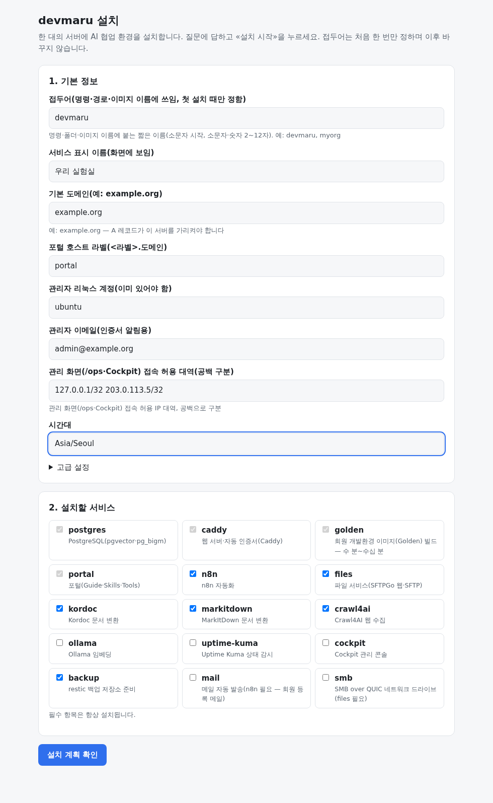
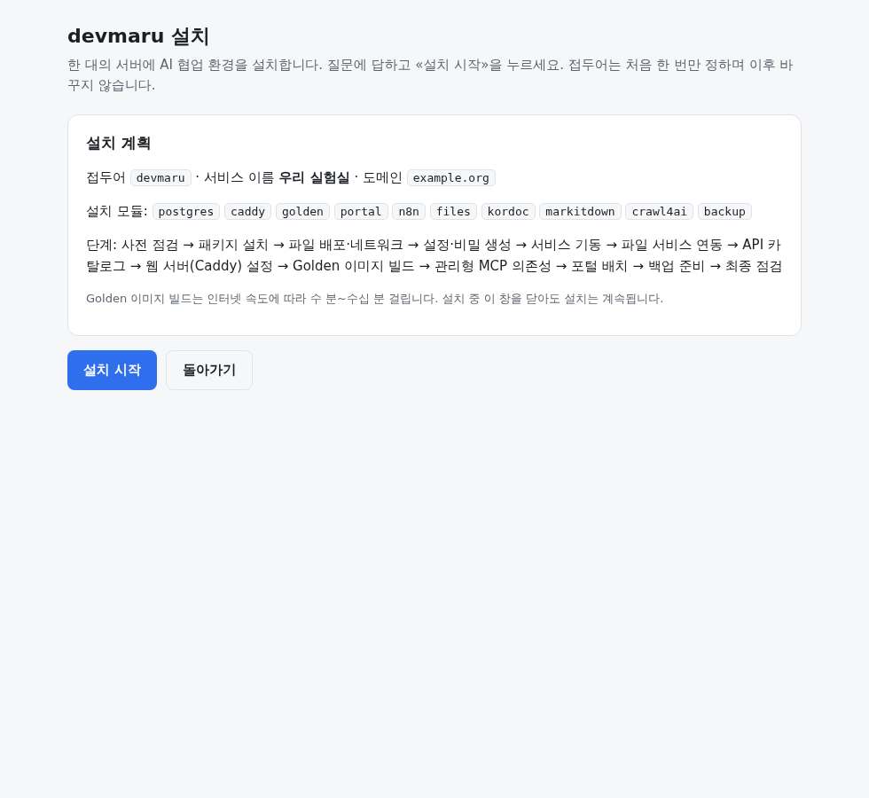
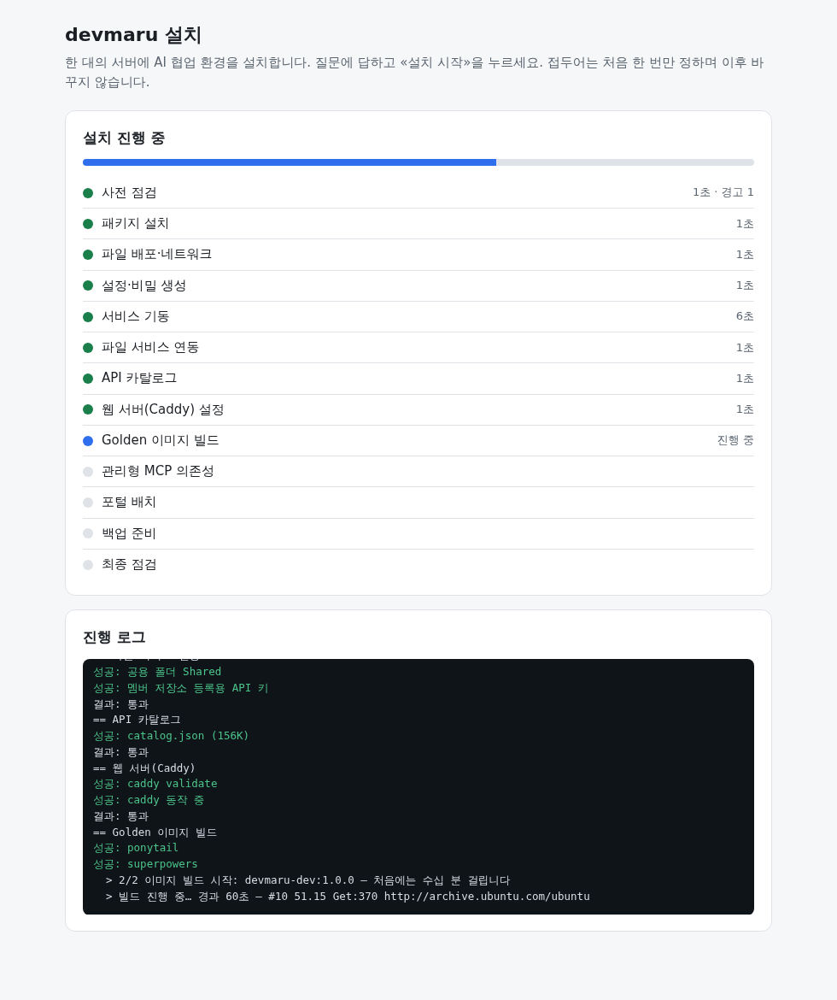
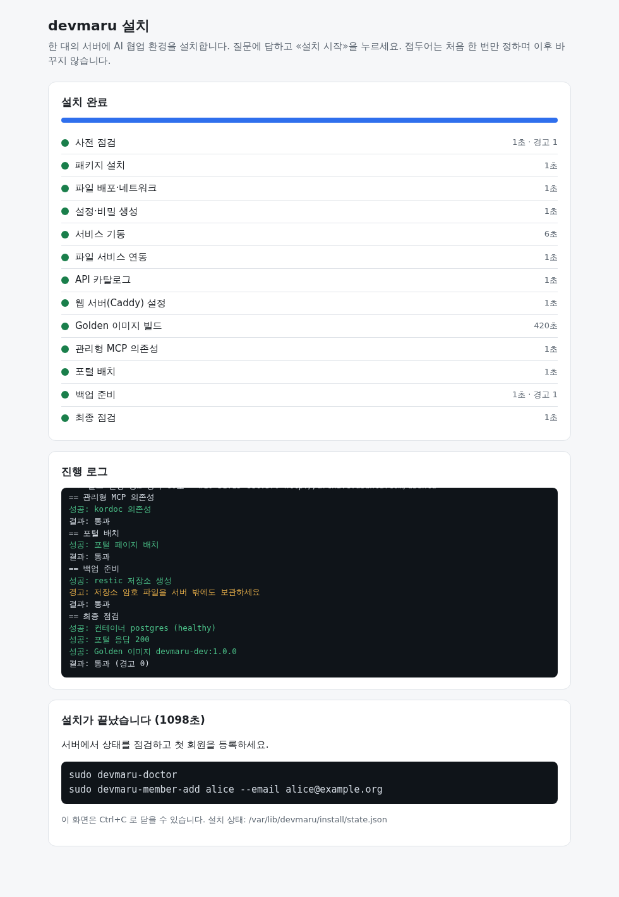
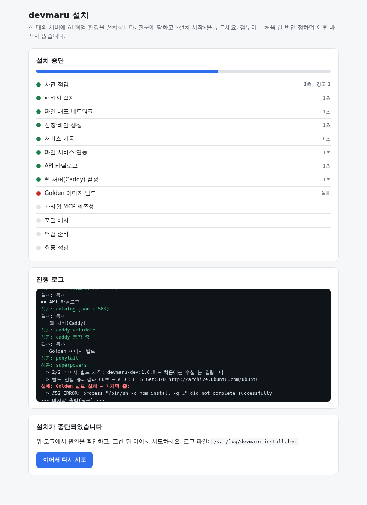
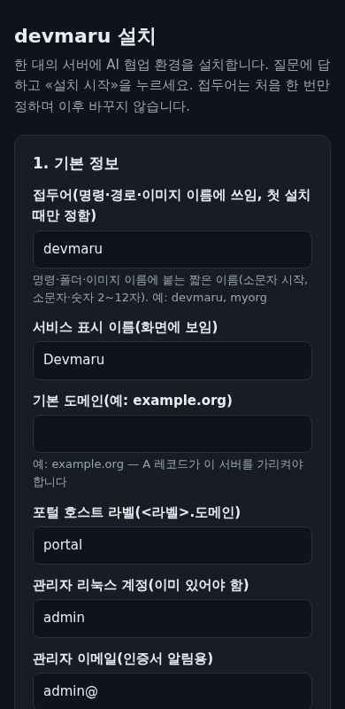

# 설치 화면 둘러보기

> 설치할 때 **무엇이 보이는지** 미리 보여 드립니다.
>
> 터미널(CLI)과 웹 화면 두 가지 방법이 있고, 둘 다 같은 설치기가 같은 단계를 실행합니다.
>
> 아래는 예시 값(접두어 `devmaru`, 도메인 `example.org`)으로 만든 화면입니다.

| | 터미널 (CLI) | 웹 화면 |
|---|---|---|
| **시작 명령** | `curl -fsSL …/install.sh \| sudo bash` | `sudo python3 …/devmaru-install --web` |
| **입력 방식** | 질문에 답하기 (Enter = 기본값) | 폼에 입력 → «설치 계획<br>확인» → «설치 시작» |
| **진행 표시** | 단계별 `[3/13]` 줄과 `성공:` 메시지 | 진행 막대 ·<br>단계 목록 · 실시간 로그 |
| **실패했을 때** | 마지막 출력과 `--resume` 안내 | «이어서 다시 시도» 버튼 |
| **추천 대상** | SSH 로 바로 설치 · 자동화(`--config … --yes`) | 처음 설치하는 분 ·<br>진행 상황을 눈으로 보고 싶을 때 |

---

## 터미널(CLI)로 설치할 때

### 1. 질문에 답하기

`[대괄호]` 안이 기본값입니다. Enter 만 누르면 그 값을 씁니다.

```text
  devmaru 설치 — 질문에 Enter 만 누르면 [기본값]을 씁니다.

  접두어(명령·경로·이미지 이름에 쓰임, 첫 설치 때만 정함) [devmaru]:
  서비스 표시 이름(화면에 보임) [Devmaru]: 우리 실험실
  기본 도메인(예: example.org) []: example.org
  포털 호스트 라벨(<라벨>.도메인) [portal]:
  관리자 리눅스 계정(이미 있어야 함) [ubuntu]:
  관리자 이메일(인증서 알림용) [admin@example.org]:
  관리 화면(/ops·Cockpit) 접속 허용 대역(공백 구분) [127.0.0.1/32 203.0.113.5/32]:
  시간대 [Asia/Seoul]:

  설치할 선택 서비스를 고르세요(필수: postgres, caddy, golden, portal)
  n8n 설치? (y/n) [y]:
  files 설치? (y/n) [y]:
  kordoc 설치? (y/n) [y]:
  markitdown 설치? (y/n) [y]:
  crawl4ai 설치? (y/n) [y]:
  ollama 설치? (y/n) [n]:
  uptime-kuma 설치? (y/n) [n]:
  cockpit 설치? (y/n) [n]:
  backup 설치? (y/n) [y]:
```

### 2. 계획 확인

입력한 값으로 무엇을 할지 한 번 보여 주고, 마지막으로 확인을 받습니다.
`--plan` 옵션을 쓰면 **아무것도 바꾸지 않고** 여기까지만 보여 줍니다.

```text
  접두어 devmaru · 서비스 '우리 실험실' · 도메인 example.org · GID 1001
  모듈: postgres caddy golden portal n8n files kordoc markitdown crawl4ai backup
  단계: 사전 점검 → 패키지 설치 → 파일 배포·네트워크 → 설정·비밀 생성 → 서비스 기동 → 파일 서비스 연동
        → API 카탈로그 → 웹 서버(Caddy) 설정 → Golden 이미지 빌드 → 관리형 MCP 의존성 → 포털 배치
        → 백업 준비 → 최종 점검
  이대로 설치할까요? (y/n) [y]:
```

### 3. 진행

단계마다 `[번호/전체]` 줄이 나오고, 그 아래에 `성공:` · `경고:` · `실패:` 메시지가 이어집니다.

```text
[1/13] 사전 점검
    == 사전 점검
    성공: Ubuntu 26.04
    성공: 메모리 16GB
    성공: /srv 여유 120GB
    성공: 인터넷 https://github.com (200)
    성공: DNS portal.example.org → 203.0.113.10
    결과: 통과
    → 완료 1초, 경고 1
[2/13] 패키지 설치
    …
[5/13] 서비스 기동
    == 서비스 기동
      > postgres 이미지 빌드(pgvector · pg_bigm 컴파일, 몇 분 걸림)
    성공: 이미지 devmaru-postgres:18-pgvector087-bigm
    성공: postgres (postgres)
    성공: n8n (n8n)
    성공: files (sftpgo)
    성공: kordoc (kordoc)
    결과: 통과
    → 완료 36초
[9/13] Golden 이미지 빌드
      > 2/2 이미지 빌드 시작: devmaru-dev:1.0.0 — 처음에는 수십 분 걸립니다
      > 빌드 진행 중… 경과 60초 — #10 51.15 Get:370 http://archive.ubuntu.com/ubuntu
      > 빌드 진행 중… 경과 120초 — …
```

> **Golden 이미지 빌드가 가장 오래 걸립니다.**
>
> 긴 단계는 1분마다 `빌드 진행 중… 경과 N초` 줄이 나와서 멈춘 것이 아님을 알 수 있습니다.

### 4. 끝났을 때

```text
  ✓ 설치 완료 (1098초). 상태: /var/lib/devmaru/install/state.json
  다음: sudo devmaru-doctor
```

### 5. 실패했을 때

어느 단계에서 멈췄는지, 마지막 출력, 이어서 실행하는 방법이 표시됩니다.

```text
    --- 마지막 출력(원문) ---
    #52 ERROR: network timeout at https://registry.npmjs.org/
    실패: Golden 빌드 실패
    결과: 실패

  ✗ Golden 이미지 빌드 단계 실패(코드 1). 로그: /var/log/devmaru-install.log
  고친 뒤 이어서: sudo python3 /opt/devmaru-kit/bin/devmaru-install --config /etc/devmaru/site.env --yes --resume
```

완료된 단계는 건너뛰고 **실패한 단계부터** 다시 실행합니다.

---

## 웹 화면으로 설치할 때

터미널에 표시된 주소(`http://127.0.0.1:8765/?t=…`)를 브라우저에서 엽니다.
PC 에서 열려면 먼저 SSH 터널을 만듭니다. 자세한 방법은 [설치 가이드](INSTALL.md)를 보세요.

### 1. 정보 입력과 서비스 선택



필수 서비스(postgres · caddy · golden · portal)는 항상 선택된 채로 잠겨 있습니다.
접두어를 바꾸면 서비스 이름이, 도메인을 바꾸면 관리자 이메일이 자동으로 채워집니다.

### 2. 설치 계획 확인



입력한 값과 실행될 단계를 확인하고 «설치 시작»을 누릅니다.
창을 닫아도 설치는 서버에서 계속됩니다.

### 3. 진행 중



- 완료 · 진행 중 · 대기 순서로 단계 상태가 바뀝니다.
- 위쪽 막대는 전체 진행률입니다.
- 아래 로그는 터미널 출력과 같은 내용이며 `성공` · `경고` · `실패` 가 색으로 구분됩니다.

### 4. 설치 완료



화면 아래에 다음에 실행할 명령(`devmaru-doctor`, `devmaru-member-add`)이 나옵니다.
터미널에서 `Ctrl+C` 로 웹 설치 화면을 닫으세요.

### 5. 실패했을 때



실패한 단계는 로 표시되고, 로그에 원인이 남습니다.
원인(대개 일시적인 네트워크 오류)을 확인한 뒤 **«이어서 다시 시도»** 를 누르면 실패한 단계부터 다시 실행합니다.

### 모바일 · 다크 모드



화면은 휴대폰에서도 보이고, 기기의 다크 모드 설정을 따릅니다.

---

## 어떤 방법을 고를까요

- **처음 설치하거나 화면으로 확인하고 싶다** → 웹 화면
- **SSH 로만 접속한다 · 스크립트로 자동화한다** → 터미널 (`--config site.env --yes` 로 질문 없이도 가능)
- 두 방법 모두 설정은 `/etc/<접두어>/site.env`, 진행 상태는 `/var/lib/<접두어>/install/state.json` 에 기록합니다.

> 설치 순서 전체는 [설치 가이드](INSTALL.md), 구조는 [구조 문서](ARCHITECTURE.md)를 보세요.
